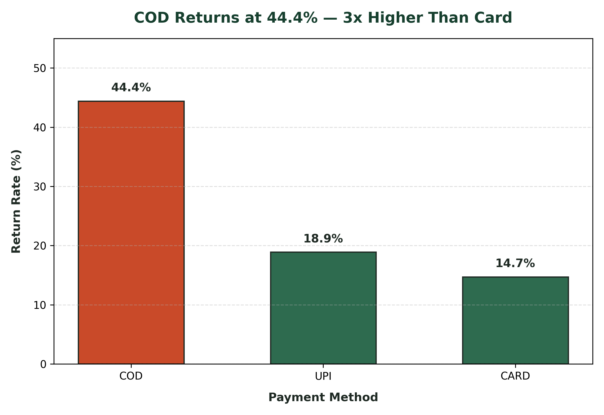
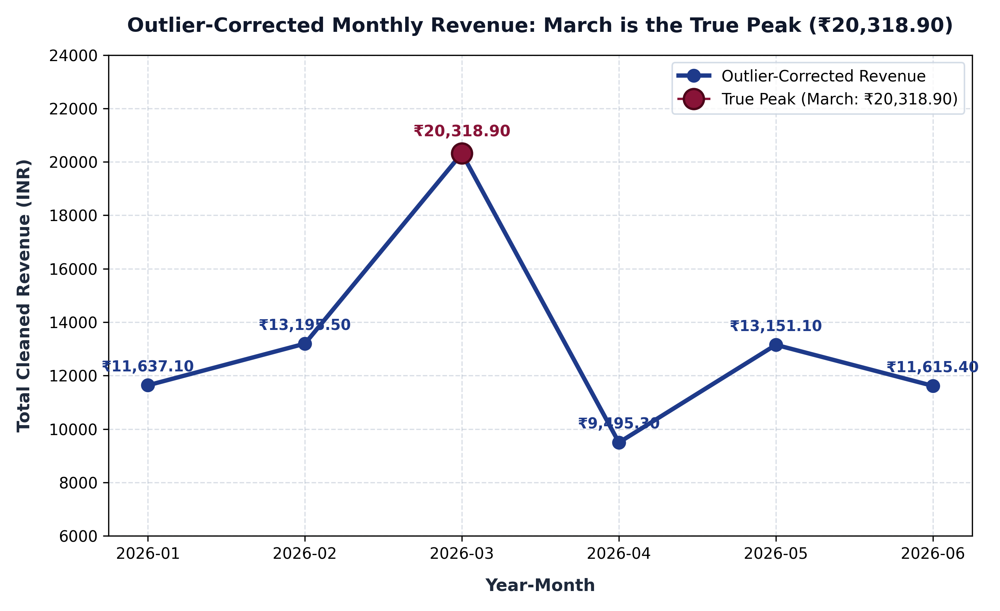

# Mamaearth Returns & Growth Intelligence Pipeline

**Program:** Data Analytics with AI & Gen AI · E&ICT Academy IIT Roorkee  
**Domain:** E-Commerce Growth Analytics & Financial Reconciliation  
**Objective:** End-to-end intelligence pipeline proving where product returns impact operating margins, identifying the true organic revenue picture after data cleaning, and generating executive SCR (Situation-Complication-Resolution) narratives.

---

## 🌟 Executive Summary & Golden Rule

> **Golden Rule:** No layer may report a number it did not compute itself or receive from the layer before it.

1. **Part 1 (SQL Relational Layer):** Audited the raw transaction store (180 orders), identifying unrated orders, zero-order customers, and raw top-line revenue of **₹99,860.20** across categories and cities.
2. **Part 2 (Python / Pandas EDA & Wrangling):** Standardized casing, removed 5 duplicate double-submitted orders (`O0176`–`O0180`), imputed missing values, isolated bulk outliers (`O0011`, `O0098`), and mathematically reconciled the cleaned revenue to **₹97,358.30** (an exact **₹2,501.90** duplicate variance). It proved that **Cash-on-Delivery (COD)** return rate is **44.4%** (vs Card 14.7%), peaking at **54.5% in Tier-2 cities**, and corrected the true peak month to **March 2026 (₹20,318.90)**.
3. **Part 3 (GenAI Narrative Layer):** Ingests verified metrics from `narrator/findings.json` and produces an executive SCR briefing via Google Gemini API with a deterministic offline fallback path and automated numeric accuracy validation (5/5 checks passed).

---

## ⚡ Quickstart (One-Command Full Pipeline Run)

To run the entire 3-layer pipeline, execute the master orchestrator:

```bash
python run_pipeline.py
```

This single command automatically performs:
1. **SQL Initialization & Reporting:** Executes DDL schema, loads raw seed records, and tests all 9 business reports against SQLite.
2. **Python Data Wrangling & EDA:** Standardizes text casing, eliminates duplicate orders, imputes missing statistics, calculates IQR outliers, performs financial reconciliation, and outputs `narrator/findings.json`.
3. **Visualization Generation:** Produces and saves the 2 high-resolution analytical PNG charts in `visualizations/`.
4. **GenAI Insight Narrator:** Generates the executive SCR business briefing with automated 5-point numeric accuracy verification.

---

## 📖 Data Dictionary & Quality Anomaly Matrix

### 1. Entity Schema Summary
- **`customers.csv` (45 rows):** `customer_id` (PK), `name`, `city`, `city_tier` (1 or 2), `signup_date`, `acquisition_source` (`Ad`, `Organic`, `Referral`, `Social`).
- **`products.csv` (16 rows):** `product_id` (PK), `product_name`, `category` (Haircare, Skincare, Babycare, PersonalCare), `price` (INR).
- **`orders.csv` (180 rows):** `order_id` (PK), `customer_id` (FK), `product_id` (FK), `order_date`, `quantity`, `discount_pct`, `payment_method`, `rating`, `returned`.

### 2. Intentional Data Anomalies & Resolution Strategy
| Anomaly Type | Occurrences | Business Impact | Python Cleaning Strategy |
| :--- | :--- | :--- | :--- |
| **Inconsistent Casing** | 7 raw variations (`COD`, `cod`, `Card`, `card`, `CARD`, `UPI`, `upi`) | Fragmentation of channel metrics | `.str.strip().str.upper()` standardizes to canonical `CARD` (70), `UPI` (55), `COD` (55). |
| **Duplicate Orders** | 5 rows (`O0176`–`O0180`) | Double-counted revenue (+₹2,501.90) | `.drop_duplicates(subset=[natural_key])` drops the 5 ghost submissions. |
| **Missing Promo Discounts** | 12 blank cells | Undefined pricing calculation | Filled with `0%` (business rule: standard full-price order). |
| **Missing Customer Ratings** | 15 blank cells | Skewed feedback averages | Imputed with column median (`3.0`) computed on deduplicated data. |
| **Bulk Quantity Outliers** | 2 rows (`O0011` qty 25, `O0098` qty 30) | Distorts January revenue as false peak | Flagged via IQR rule ($[-0.5, 3.5]$); retained in data but isolated in trend analytics. |

---

## 📁 Repository Structure

```text
<repo>/
├── README.md                           # Front-door documentation & reproduction guide
├── requirements.txt                    # Python runtime dependencies
├── sql/
│   ├── schema.sql                      # DDL schema (customers, products, orders)
│   ├── seed_data.sql                   # Re-runnable raw seed loader with NULL handling
│   └── reports.sql                     # 9 business reports with verbatim outputs
├── data/
│   ├── customers.csv                   # Raw customer records (45 rows)
│   ├── products.csv                    # Raw product catalog (16 rows)
│   └── orders.csv                      # Raw orders dataset (180 rows, intentionally messy)
├── analysis/
│   ├── clean_and_eda.py                # Tasks 1-10 wrangling, EDA & findings.json exporter
│   └── visualize.py                    # Task 11 chart generation script
├── visualizations/
│   ├── return_rate_by_payment.png      # Publication-quality Return Rate Bar Chart
│   └── monthly_revenue_trend.png       # Publication-quality Outlier-Corrected Line Chart
└── narrator/
    ├── findings.json                   # Machine-generated verified figures
    ├── generate_narrative.py           # GenAI SCR generator (Gemini + Offline Fallback)
    └── sample_output.txt               # Verified narrative output & validation report
```

---

## 🚀 Step-by-Step Reproduction Guide

### Prerequisites
- Python 3.10+
- SQLite3 CLI or Python `sqlite3`

Install dependencies:
```bash
pip install -r requirements.txt
```

---

### Phase 1: SQL Relational Layer & Reporting

Run SQLite to execute the schema, seed data, and report queries:

```bash
# Initialize database and load tables
sqlite3 mamaearth.db < sql/schema.sql
sqlite3 mamaearth.db < sql/seed_data.sql

# Execute business reports
sqlite3 mamaearth.db < sql/reports.sql
```

#### SQL Reports Summary:
- **Report (a) Order Totals:** `total_orders = 180`, `total_revenue = ₹99,860.20`, `avg_order_value = ₹554.78`
- **Report (b) Missing Ratings:** `180 total`, `165 rated`, `15 unrated`
- **Report (c) Zero-Order Customer:** `C045 (Vihaan)` verified via both `LEFT JOIN` and `NOT IN`
- **Report (d) High Return Rate Cities (>20%):** Jaipur (42.1%), Lucknow (30.6%), Bangalore (24.2%)
- **Report (e) Top Spenders:** C043 Reyansh (₹12,920.00), C026 Isha (₹8,371.60), C008 Meera (₹4,564.60), C011 Arjun (₹4,111.00), C042 Sanya (₹3,785.00)
- **Report (f) Product Categories:** Haircare (₹44,956.10), Skincare (₹27,346.00), Babycare (₹16,805.00), PersonalCare (₹10,753.10)
- **Report (g) Pattern Matching:** 10 customers with names starting with `'A'`
- **Report (h) Acquisition Channels:** 4 unique sources (`Ad`, `Organic`, `Referral`, `Social`)
- **Report (i) Loyalty Tiers:** 28 `Gold` (Tier-1), 17 `Silver` (Tier-2)

---

### Phase 2: Python Data Wrangling, EDA & Visualizations

Execute the automated cleaning and exploratory analysis pipeline:

```bash
# Run data wrangling, hypothesis testing, and findings.json generation
python analysis/clean_and_eda.py

# Generate publication-quality visualization figures
python analysis/visualize.py
```

#### Python EDA Summary:
1. **Standardized Payment Methods:** 7 raw values $\rightarrow$ `CARD: 70`, `UPI: 55`, `COD: 55`.
2. **Deduplication:** Dropped 5 double-submitted rows (`O0176`–`O0180`) on natural keys $\rightarrow$ clean frame of 175 rows.
3. **Missing Value Imputation:** Imputed 12 missing `discount_pct` with `0` and 15 missing `rating` values with median `3.0`.
4. **Financial Reconciliation:** Cleaned total revenue = **₹97,358.30**. Variance vs raw Part 1 total = **₹2,501.90**, exactly matching the sum of the 5 dropped duplicate orders.
5. **IQR Outlier Flagging:** Lower bound = `-0.5`, Upper bound = `3.5`. Retained and flagged 2 bulk orders (`O0011` qty 25, `O0098` qty 30).
6. **COD Return Hypothesis (Confirmed):** COD return rate is **44.4%** vs Card **14.7%** and UPI **18.9%**.
7. **Segmentation Hotspot:** **COD + Tier-2 Cities** is the highest-risk segment at **54.5%** return rate (vs Tier-1 COD at 37.5%).
8. **Correlation Analysis:** All 6 pairwise correlations between rating, returned, discount, and quantity are negligible ($|r| < 0.20$). Discount vs return rate $r = -0.088$ (Hypothesis "Discounts reduce returns" is **Busted**).
9. **Outlier-Corrected Time Series:** January's apparent revenue lead (₹29,582.10) was inflated by bulk orders; **March 2026** is the genuine peak organic month at **₹20,318.90**.

---

### Phase 3: GenAI-Powered Insight Narrator

Generate the executive SCR narrative report:

#### Option A: Online Path (Using Google AI Studio Key)
```bash
# Set your free Gemini API key
export GEMINI_API_KEY="your_api_key_here"   # Linux/macOS
$env:GEMINI_API_KEY="your_api_key_here"     # Windows PowerShell

python narrator/generate_narrative.py
```

#### Option B: Offline Fallback Path (Zero API Key / Zero Spend)
```bash
# Unset any existing key to run the deterministic offline path
python narrator/generate_narrative.py
```

---

## 🔍 Task 5: Automated Numeric Accuracy Verification

The script `narrator/generate_narrative.py` automatically asserts that all five required figures appear in the narrative:

| Metric | Target Value | Status |
| :--- | :--- | :---: |
| Cleaned Total Revenue | `₹97,358.30` | **PASS** |
| COD Return Rate | `44.4%` | **PASS** |
| COD Tier-2 Highest-Risk Segment | `54.5%` | **PASS** |
| Duplicate Reconciliation Delta | `₹2,501.90` | **PASS** |
| True Peak Month & Revenue | `March (₹20,318.90)` | **PASS** |

---

## 📊 Visualizations

### 1. Return Rate by Payment Method
The chart below illustrates the ~3x disparity between Cash-on-Delivery (44.4%) and prepaid payment channels (Card: 14.7%, UPI: 18.9%):



---

### 2. Outlier-Corrected Monthly Revenue Trend
The chart below shows the revenue trajectory across H1 2026, highlighting **March (₹20,318.90)** as the genuine organic peak month once the two January bulk anomalies are isolated:


